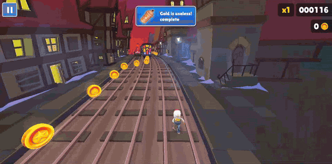
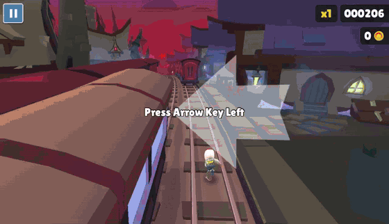

# Verify plays Subway Surfers

An agent that plays [Subway Surfers on Poki](https://poki.com/en/g/subway-surfers) in a Revyl cloud browser, or on a Revyl cloud Mac, driven through the [Verify SDK](https://www.npmjs.com/package/@revyl/verify). It reads each screenshot with plain pixel checks, not a model. It gets through the game's tutorial by sending each key ahead of the prompt it expects, then dodges trains and barriers on its own until it crashes, usually within a few seconds.

| Cloud browser, `npm start` | Mac, `npm run mac` |
|---|---|
|  |  |

Both clips are true speed. The browser clip is 10 s from the longest browser run so far. The Mac clip is the end of the tutorial and the short run after it, from Revyl's recording of the computer, which runs at about 8 fps.

Everything runs on a real cloud machine over the network. On a cloud browser, each decision lands about a second and a half after the frame it was based on. On a Mac, it lands in a little over half a second. The numbers below show how far the agent gets with that.

## Run it

1. `npm install` (Node 22.18 or newer).
2. Copy `.env.example` to `.env` and fill in `REVYL_API_KEY` and `REVYL_APP_ID`. The app id is any Revyl web app. To create one, see Verify's [web guide](https://github.com/RevylAI/verify/blob/main/packages/verify/docs/web.md#create-the-web-app): in the Revyl dashboard click **Create app**, keep **Web** selected and enter any public HTTPS URL, or run `revyl app create --name "Subway Surfers" --platform web`.
3. `npm start`.

Each run opens one Revyl cloud browser session, plays for up to `PLAY_SECONDS` (360 by default) or `RUNS` runs (3 by default), and closes the session when it ends, errors included. The terminal prints the session link first, so you can watch live. After that it prints one line per screenshot, saying what the agent saw and which key it sent.

## Run it on a Mac

`npm run mac` plays the same agent on a Revyl cloud Mac, through Verify's computer API. Mac computers need a paid Revyl plan. This path needs only `REVYL_API_KEY` in `.env`, with no app id. `PLAY_SECONDS` and `RUNS` work the same way.

`src/mac.ts` opens Safari on the game, taps Poki's fullscreen button, and hands the computer to the same `play()`:

```ts
const computer = await open({ platform: 'mac', startTimeout: 600_000 });
try {
  await computer.exec(['open', '-a', 'Safari', GAME_URL]);
  await sleep(15_000);
  await computer.tap({ target: 'Fullscreen button in the white bar under the game' });
  // ... tap the game until a run starts
  await play(
    { screenshot: () => computer.screenshot(), pressKey: (key) => computer.pressKey(key), tap: (at) => computer.tap(at) },
    { budgetMs, runs, print: (line) => console.log(line) },
  );
} finally {
  await computer.close();
}
```

This path is plain Verify, with no direct call. A computer's `pressKey()` and `tap()` don't wait for the screen to settle, so a key comes back in about a third of a second. In our sessions the computer was ready about 9 s after `open()`, and the game was playing about 30 s later.

## How it works

`src/main.ts` is the whole Verify side for the browser:

```ts
const session = await open({ platform: 'web', app: { appId, url: GAME_URL }, viewport: { width: 960, height: 540 } });
try {
  await session.tap({ target: 'Fullscreen button in the white bar under the game' });
  while (!isPlaying(decodeFrame(await session.screenshot()))) {
    await session.tap(START_TAP);
    await sleep(3000);
  }
  const input = withFastInput(session);
  await play(
    { screenshot: () => session.screenshot(), pressKey: input.pressKey, tap: input.tap },
    { budgetMs, runs, print: (line) => console.log(line) },
  );
} finally {
  await session.close();
}
```

- **Seeing** (`src/vision.ts`): it fits the perspective pattern of the rails to find the track and the runner's lane. It then follows each rail into the distance and marks a lane as blocked where its rails disappear behind something. It also reads the tutorial prompts from the widths of their words, the pause button to tell that a run is on, and the PLAY button on the score board. All of this is measured on the browser's 960x476 game area. On the Mac's 1280x736 game area the game scales its track and buttons mostly with the height, so the agent scales its measurements by the width ratio to the power 0.2 times the height ratio to the power 0.8, which matched the Mac's rails and pause button.
- **The tutorial** (`src/agent.ts`): a fresh game always starts with it. The prompts are Up, Down, Left, Right and Left, then Space for the hoverboard. Each prompt takes its key for only about a second, which is less than one screenshot-and-key round trip on a browser, so a key sent after seeing the prompt arrives too late. A missed prompt replays on a steady cycle of about 3–5 s, and Left comes about a second after Right. The agent learns both timings from what it sees. It sends each key ahead of time so that Revyl answers it about half a second after the prompt it expects, timed by the median of its last nine key round trips, and shifts its aim slightly after each miss. It usually finishes in 2–3 minutes.
- **Free play**: as soon as anything shows up in the runner's lane, the agent moves to the lane that is clear or blocked farthest away, two lanes over if needed. If no lane is better, it jumps when the obstacle gets close. It only acts on screenshots taken after its last key landed.
- **Restarts** (`src/play.ts`): after a crash it waits out "Save me!" and the ad break, presses Space to continue, then taps PLAY. It stops pressing Space once it has tapped PLAY, because Space at the start of a run uses up a hoverboard. Poki sometimes shows an ad of about 30 s after PLAY, and in one session the game replayed its tutorial on the next run. The agent waits out the first and passes the second again.

## On a browser, keys and taps use a temporary direct call

`src/fast-input.ts` sends keys and taps through an undocumented Revyl endpoint. That's because Verify 0.6.3's `pressKey()` and `tap()` wait for the page to settle after every action, and a running game never settles. Each key took about 6 s, and a tap on PLAY held up screenshots for the first 6 s of the next run. The module sends the same actions with that wait skipped, through the SDK's own client, and needs nothing but `REVYL_API_KEY`. It will move to a Verify option once one ships, and the file will be deleted. With settling off, a screenshot taken right after a key can still show the frame from before it. So the agent ignores any screenshot captured before Revyl answered the last key. The Mac path doesn't need this.

## Measured limits

Measured on production Revyl in November 2026:

| What | Cloud browser | Mac |
|---|---|---|
| Game area | 960x476, in a 960x540 browser | 1280x736, on a 1280x800 screen in Safari fullscreen |
| Screenshot round trip, median per session | 0.86–1.06 s, three requests in flight | 0.41 s in all 3 sessions, three requests in flight |
| Key, from send to Revyl's answer, median per session | 0.77–1.03 s | 0.34–0.35 s |
| Tutorial | passed in every session that played long enough (7 passes in 6 sessions), in 114–192 s | passed in all 3 sessions, in 113–154 s |
| Free play with this code | 4.9, 3.2 and 1.6 s | 5.5, 3.1, 3.8 and 1.3 s |

A run that follows the tutorial starts on the hoverboard the tutorial hands out, which absorbs one crash. An earlier version also pressed Space at the start of every later run, which spent a hoverboard each time. With that extra life, browser runs lasted up to 26.8 s.

Runs are short. At the game's starting speed, an obstacle is visible for about 1–2 s before it reaches the runner, and an oncoming train for about 1 s. On a browser the agent needs about 1.4 s from a screenshot being taken until its key takes effect, so it survives only by moving the moment something appears. On a Mac that delay is less than half as long, yet the runs are no longer, and the reason isn't pinned down. The crashes in the Mac recordings are trains and barriers that the agent saw late or misread, at the start of a run, in tunnels and on the magenta floors. Its vision was tuned on the browser's game area. In 2 of the 3 Mac sessions, screenshots also failed for about 3 s with "The computer desktop is not ready for screenshots". The agent retries them and carries on.

## Left out

- **A model that decides each move.** A model call per frame would add a second or more to a loop that is already slower than the game.
- **Faster channels outside Verify's API.** Reading the session's live video stream would cut the delay, but that stream isn't part of the SDK.

## License

[Apache-2.0](LICENSE). Subway Surfers is a game by SYBO, hosted on Poki. This project plays it in a browser and isn't affiliated with either.
